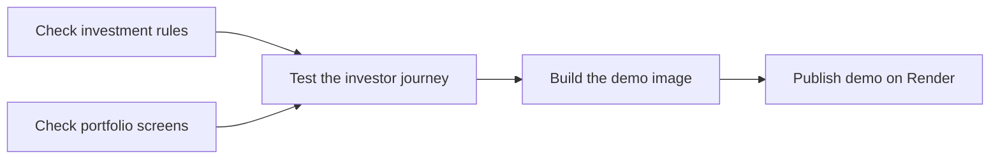

# Enviro365 Investments

An investor portfolio and withdrawal application with a Next.js/React frontend and
**Java 21 / Spring Boot 4.1.2 / Spring Data JPA / H2** backend. It records withdrawal
notices and reservations, with no authentication or payment processing.

[Live demo](https://enviro365-investments.onrender.com) ·
[Demo deployment](https://github.com/Eleazarovich/enviro365-investments/deployments/activity_log?environments_filter=demo)

The free Render demo may take a moment to wake up. It uses shared fictional data;
notices reset when Render replaces the instance. Local H2 data persists across restarts.

## Run locally

Install a Java **21 JDK**, Node.js **24**/npm, GNU Make and Bash **4.3+** (Linux or WSL).
From the project root:

```sh
make run
```

This installs frontend dependencies when needed, creates `frontend/.env.local` if
missing, and starts both services. Open http://localhost:4028; press **Ctrl+C** to
stop both. If either service exits, the other is stopped too. Existing local
configuration is preserved. Stop any separately running development servers first
so ports 4028 and 8080 are available.

Run `make help` for all commands. `make backend` and `make frontend` start services
separately; `make test` runs backend tests, `make check` checks frontend types and lint,
`make build` builds both applications, and `make test-e2e` runs the browser suite against Spring Boot/H2.
`make clean` removes build output while retaining H2 data and local configuration.
Browser targets require Chromium (`cd frontend && npx playwright install chromium`).

To start services manually, from `backend/`:

```sh
./mvnw spring-boot:run
```

In a second terminal, from `frontend/`:

```sh
npm ci
cp .env.example .env.local
npm run dev
```

Open http://localhost:4028. The frontend defaults to HTTP at http://localhost:8080.
Configure `NEXT_PUBLIC_API_BASE_URL` (without `/api`) in `.env.local`; restart
Next.js after changing it. The frontend always calls Spring Boot; there is no
separate browser database or mock mode. Do not place secrets in public variables.

The [backend README](backend/README.md) covers structure, configuration, H2 inspection,
seed data, endpoints, locking and assumptions. The Maven Wrapper pins Maven 3.9.16;
npm dependencies use the existing lockfile.

## Data and withdrawal rules

A fresh database seeds investor **1**, fictional **Eleazarovich**, and two investments.
Cash has R100,000 underlying, R20,000 reserved, R80,000 available and a R70,000 maximum.
Retirement has R60,000 available and a R54,000 maximum. Nine existing notices provide
filterable history. File-backed H2 in `backend/data/` retains notices across restarts.

Active submitted notices share a **cumulative cap of 90% of the underlying product
balance**, rounded down to cents. Reservations reduce available funds immediately
and exactly once. Each request must be at least R100 and may include cents. A zero
maximum means no request fits; the actual balance remains visible. Retirement
requires age **strictly greater than 65**.

See [business rules and the withdrawal walkthrough](_docs/business-rules.md) for
worked examples and a short explanation of the transaction.

## API

| Method | Endpoint | Purpose |
| --- | --- | --- |
| GET | `/api/investors/{investorId}/portfolio` | Investor and products with current balances and limits |
| POST | `/api/investors/{investorId}/withdrawal-notices` | Create a notice with `{ "productId": 1, "amount": 1500.75 }` |
| GET | `/api/investors/{investorId}/withdrawal-notices` | History with optional `productId`, `fromDate`, `toDate` filters |
| GET | `/api/investors/{investorId}/withdrawal-notices/export` | CSV with the same filters |

See [openapi.yaml](openapi.yaml) for complete schemas, inclusive UTC date filters and
errors. JSON withdrawal amounts are positive; the UI and CSV show negative deductions.
CSV columns are `Date,Investment,Amount`. Configure local CORS through
`CORS_ALLOWED_ORIGINS`; the backend exposes `Content-Disposition` to the browser.

## Verification

From `backend/`:

```sh
./mvnw -B -ntp clean verify
```

From `frontend/`:

```sh
npm ci
npm run type-check
npm run lint
npm run build
npx playwright install --with-deps chromium
npm run test:e2e
```

On Linux, `--with-deps` requires permission to install system packages. If the
libraries are already installed, `npx playwright install chromium` is sufficient.

Spring Boot manages JUnit Jupiter **6.0.3** and Mockito. Standard
`@SpringBootTest` / `@AutoConfigureMockMvc` tests use real H2 and cover rules,
concurrency, rollback, errors, filtering and CSV. The restart test deliberately
starts two application contexts to check file persistence. OpenAPI remains API
documentation; tests use direct response assertions.

One Playwright suite runs six tests against a disposable Spring Boot/H2 server on
**8081** and Next.js on **4029** (`.next-e2e`). It covers portfolio loading, valid
and invalid withdrawals, refreshed balances/history, filtered CSV downloads, real
backend error feedback and mobile navigation. No Docker or database-reset scripts
are needed. Each run starts with fresh in-memory data and leaves local H2 data alone.

## Continuous integration and Render

[Portfolio checks](.github/workflows/ci.yml) runs on pull requests targeting `main`,
pushes to `main`, and **Actions → Portfolio checks → Run workflow**. The first two
jobs run in parallel. Each later stage waits for the preceding checks to pass:



The image build and Render deployment apply to pushes to `main`. A failed or
cancelled stage prevents the remaining stages from running. Nothing runs on a timer.
Jobs use Ubuntu 24.04 with Java 21 and Node 24 (matching the Dockerfile's major versions).
Maven and npm downloads are cached; `npm ci` uses the checked-in lockfile.
Superseded runs for the same PR/branch and event are cancelled. Manual runs do not
cancel push checks needed by Render.

| Job | Checks | When |
| --- | --- | --- |
| Check investment rules | Java tests for balances, age eligibility, withdrawal limits, persistence, errors and CSV; package the backend | Starts immediately |
| Check portfolio screens | Install locked dependencies, check TypeScript and lint, build the frontend export | Starts alongside investment rules |
| Test the investor journey | Browser tests against real Spring Boot/H2: portfolio, withdrawals, filters, statements and mobile navigation | After both initial jobs pass |
| Build the demo image | Existing multi-stage Docker build, including its checks | After the investor journey passes; pushes to `main` only |
| Publish demo on Render | Render builds and publishes the checked commit | After all GitHub checks pass; handled by Render |

The local commands above reproduce the first three jobs. Set `CI=true` when running
Playwright to also generate GitHub annotations and an HTML report. Ports **8081** and
**4029** must be free; Playwright starts both servers itself and uses one worker for
the shared disposable H2 database. Only Chromium is installed. From the repository
root, verify deployment packaging with Docker running:

```sh
docker build --progress=plain --tag enviro365:ci .
```

The existing suites cover the portfolio workflows and financial rules:

| Feature area | Existing coverage |
| --- | --- |
| Portfolio and DTO responses | `PortfolioServiceTest`, `WithdrawalIntegrationTest`, dashboard/detail browser test |
| Notices, balances, age >65, 90% restriction, invalid amounts | `WithdrawalRulesTest`, `WithdrawalIntegrationTest`, valid/invalid/stale-balance browser tests |
| Persistence and atomicity | `FilePersistenceTest`, integration rollback and concurrent-request tests |
| History, product/date filters and CSV | Integration tests and browser download/content assertions |
| Five advanced options | Exception-handler tests, DTO response assertions, backend validation/unit tests, browser form validation |

To diagnose a failure, open **GitHub → Actions → Portfolio checks → failed run**, select the red
job and expand its failed step. Each command has a separate step; Maven and
Playwright logs name the failing test and show the actual error. Compilation/build
steps identify packaging failures. Backend test failures also upload
`backend-test-reports` (Surefire text/XML). Playwright failures upload
`playwright-failure-artifacts`, including the HTML report, retained traces and
screenshots, under the run summary's **Artifacts** section for **7 days**. Download
and unzip it, then from `frontend/`:

```sh
npx playwright show-report /path/to/unzipped/playwright-report
npx playwright show-trace /path/to/unzipped/test-results/<failed-test>/trace.zip
```

Startup failures may have no trace or screenshot; inspect the E2E step's server logs.
Checks retain their failing exit codes; there are no automatic retries against the
mutating browser database.

`render.yaml` requests `autoDeployTrigger: checksPass`. Render's native
[After CI Checks Pass](https://render.com/docs/deploys#integrating-with-ci) integration
waits for the linked `main` commit's checks before building the existing Dockerfile.
A failed check prevents automatic deployment. This requires a connected GitHub
repository; a service created from a public repository URL alone cannot auto-deploy.
Render treats `neutral` and `skipped` as passing, so all four jobs actually run on a
`main` push. No hooks, deployment tokens or scripts are needed.

Deployment setup:

1. In GitHub **Settings → Actions → General**, enable GitHub Actions and allow the
   official `actions/*` actions used here. The workflow requests only `contents: read`.
   After the first run, protect `main` via **Settings → Rules → Rulesets** (or
   **Branches → Branch protection**) by requiring PRs and the three always-running
   job names above. Do not require the Docker job on PRs, where it is skipped.
2. In Render, open **enviro365-investments → Settings → Build & Deploy**. Confirm
   the connected GitHub repo is `Eleazarovich/enviro365-investments`, branch `main`,
   runtime Docker. Before pushing to `main`, set
   **Auto-Deploy → After CI Checks Pass → Save** if needed.
   For a Blueprint-managed service, sync the updated `render.yaml` from its
   **Blueprint → Manual Sync** page if automatic sync has not applied it, then
   confirm the service setting. Editing YAML alone does not update an unmanaged service.
3. A `main` push runs all four GitHub jobs. Match the commit SHA in GitHub and
   Render Deploys to confirm that publishing starts after checks finish.
   Manual Render deploys bypass the automatic gate.

The live Render service was configured to **After CI Checks Pass** on 31 October
2026 and the API confirmed `autoDeployTrigger: checksPass`. The successful hosted
CI run for `8cb2392` predates the stage ordering change. Hosted verification of the
updated order is pending; a deliberately failing main deployment has not been tested.

GitHub's deployment environment is named **`demo`** and links to the live app.
Its green status records a Render deployment verified as live; it is not an uptime
monitor. Render's native integration does not update this environment automatically.
When publishing later changes, verify the deployed SHA in Render and record its
deployment status in GitHub before treating the sidebar entry as current.
The free service retains ephemeral H2 storage; data resets when Render replaces it.

## Design previews and AI use

[Desktop portfolio](_docs/previews/rosewood-porcelain/portfolio-desktop.png) ·
[Mobile portfolio](_docs/previews/rosewood-porcelain/portfolio-mobile.png) ·
[Design system and other previews](_docs/design-system.md)

Existing screenshots document the earlier frontend phase and its previous numerical
limits. The live application uses the current cumulative cap.

OpenAI Codex assisted with frontend and backend implementation, financial calculations,
tests and documentation. Assumptions and verification are recorded so the developer can
review and explain the AI-assisted work.
