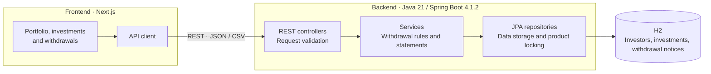
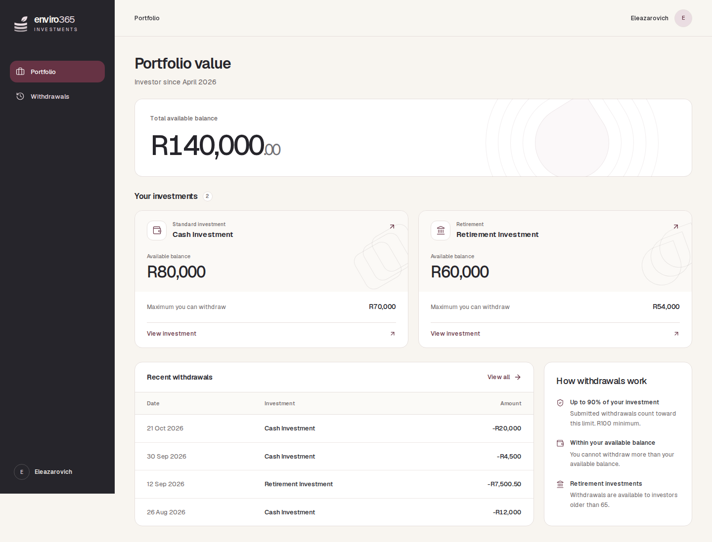
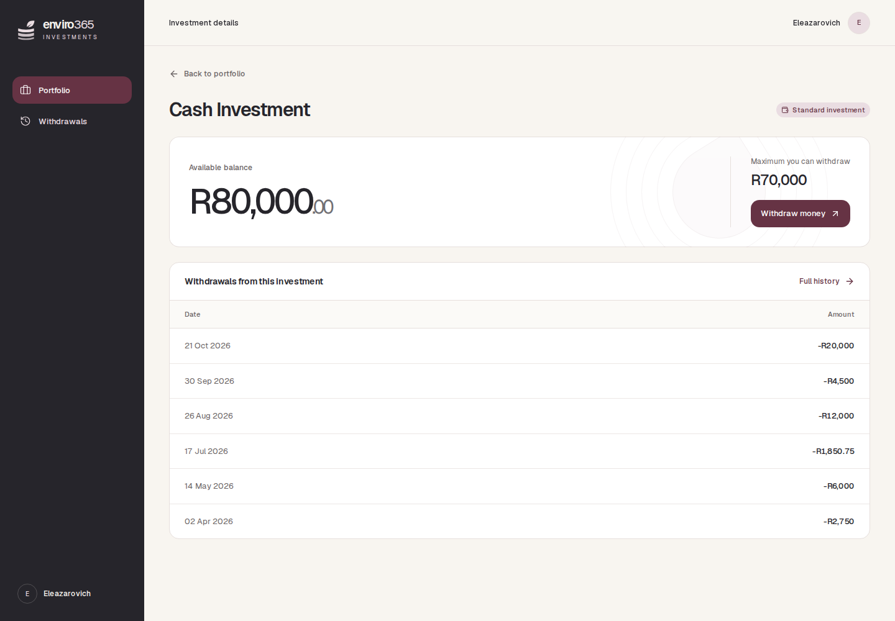
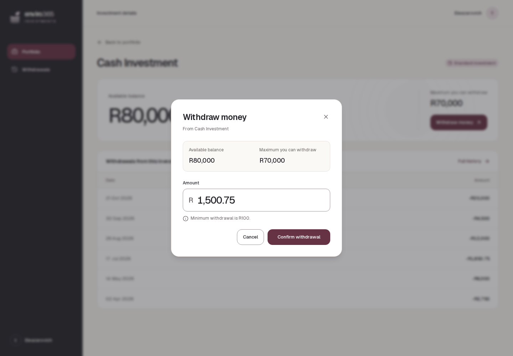
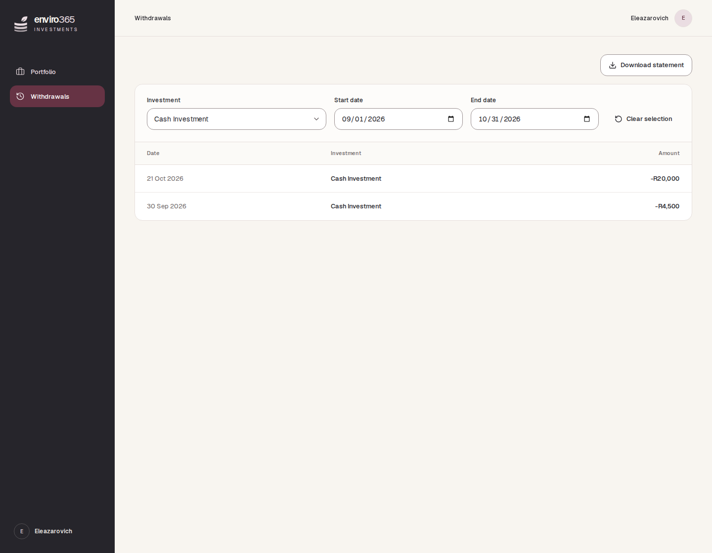

# Enviro365 Investments

An investor portfolio and withdrawal application built with Next.js, Java 21,
Spring Boot 4.1.2, and H2. Investors can view balances, submit withdrawal notices,
and download filtered CSV statements.

## Requirements coverage

| Requirement | Implementation | Status |
| --- | --- | --- |
| Portfolio retrieval | Investor details, investment products, available balances, and withdrawal limits | Implemented |
| Withdrawal notices | Persisted submissions, immediate balance reservations, and transaction locking | Implemented |
| Withdrawal history and CSV | Shared investment/date filters; `Date,Investment,Amount` columns | Implemented |
| Connected frontend | Portfolio, investment details, withdrawal form, history, and download action use the real REST API | Implemented |
| Financial rules | Retirement age >65, available-balance checks, and cumulative 90% cap per investment | Implemented |
| Advanced requirements | Global exception handling, DTOs, input validation, unit tests, and UI validation | All five implemented |

## Architecture



The frontend uses one API client. Spring Boot services enforce the withdrawal
rules; JPA repositories store investors, products, and notices in H2. A notice
reserves funds in the same transaction that creates it. Product locking prevents
concurrent requests from using the same available funds.

## Run locally

Requirements: **Java 21 JDK**, **Node.js 24/npm**, **GNU Make**, and **Bash 4.3+**
(Linux or WSL).

```sh
git clone https://github.com/Eleazarovich/enviro365-investments.git
cd enviro365-investments
make run
```

Open `http://localhost:4028`; the backend runs on `http://localhost:8080`.
`make run` installs dependencies and creates missing local configuration.
**Ctrl+C** stops both services. H2 data persists in `backend/data/`.

## Withdrawal rules

- Minimum **R100**, with at most two decimal places.
- Requests must fit the available balance and the remaining cumulative **90% cap**, rounded down to cents.
- Retirement withdrawals require age **greater than 65**; age 65 is ineligible.
- Accepted notices immediately reserve funds. Rejected requests leave data unchanged.
- If the remaining limit is below R100, withdrawals are disabled; the actual balance remains visible.

The backend supplies the minimum and maximum amounts to the UI. JSON notice amounts
are positive; tables and CSV show negative deductions. A submitted notice records
a request, not a completed bank payment.

## API

All paths start with `/api/investors/{investorId}`.

| Method | Path | Result |
| --- | --- | --- |
| GET | `/portfolio` | Investor, products, balances, and limits |
| POST | `/withdrawal-notices` | Create a notice; HTTP 201 |
| GET | `/withdrawal-notices` | History, newest first |
| GET | `/withdrawal-notices/export` | CSV statement |

POST body: `{ "productId": 1, "amount": 1500.75 }`.
History and export share optional `productId`, `fromDate`, and `toDate` filters.
Dates use `YYYY-MM-DD`, inclusive in UTC. The default investor ID is **1**.

## Verification

```sh
make test
make check
make build
cd frontend
npx playwright install chromium
npm run test:e2e
```

Recorded verification on **31 October 2026**: **58 backend tests**, **six real-API
browser tests**, TypeScript, lint, production build, and Docker build passed.
Coverage includes age and money boundaries, cumulative limits, concurrency,
rollback, persistence, errors, filtered CSV downloads, and mobile navigation.
Playwright starts isolated servers on **8081** and **4029**; keep these ports free.

GitHub Actions runs backend and frontend checks before browser tests. Successful
`main` pushes also build the container; Render deploys after the checks pass.

## Screenshots

| Portfolio | Investment details |
| --- | --- |
|  |  |

| Withdraw money | Withdrawals |
| --- | --- |
|  |  |

## AI use

Rocket.new generated the initial frontend scaffold. I used OpenAI Codex for UI
refinement, backend implementation, financial calculations, API integration,
tests, documentation, and CI/CD configuration. I supplied the requirements and
design direction.

## Documentation

| Reference | Contents |
| --- | --- |
| [Frontend README](frontend/README.md) | Frontend setup, configuration, and checks |
| [Backend README](backend/README.md) | Backend setup, persistence, validation, and errors |
| [API contract](openapi.yaml) | Complete request and response schemas |
| [Implementation checklist](_docs/TASKS.md) | Requirements and verification results |
| [Business rules](_docs/business-rules.md) | Financial calculations and worked examples |
